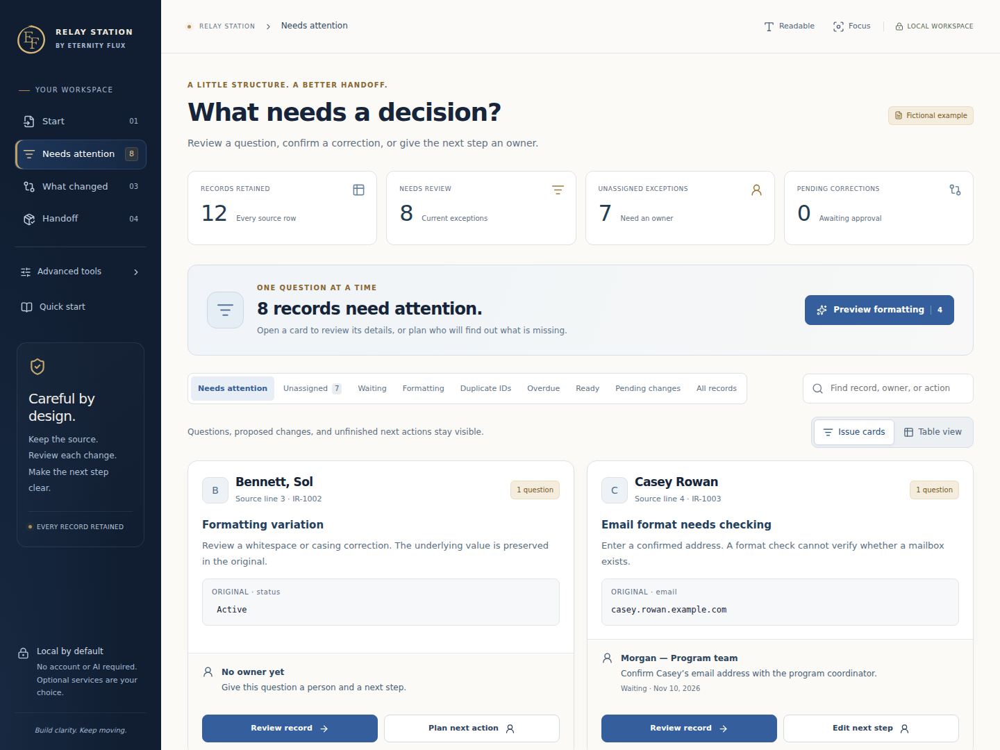

# Relay Station

**By Eternity Flux · Find what needs attention. Record the decision. Make the next step clear.**

Someone sends you a list of people, requests, or applications. Some information is missing, some looks wrong, and some needs a person to make a decision. **Relay Station** gives you a place to review the list, keep track of corrections, and hand unfinished work to a named owner.

It is a free, MIT-licensed operational handoff desk. Open a small CSV, TSV, or Excel worksheet; review the issues; approve confirmed corrections; and prepare a readable handoff with the original file intact. The core works in your browser without an account, an API key, or a server.

**v0.3.0 · Repository, local development, and offline download. The public hosted site remains paused.**

**[Download Relay Station](https://github.com/sidbug248/relay-station/raw/refs/heads/main/release/relay-station.html)** · [Step-by-step guide](docs/PRODUCT_GUIDE.md) · [Technical architecture](docs/ARCHITECTURE.md)



## Start with a real-world question

Imagine a training partner sends you twelve participant records. Two people share an ID, an email address is incomplete, and a start date could mean two different days. You need to prepare a useful handoff without losing anyone or guessing the answers.

Relay Station helps you answer:

| Question | Where to work |
| --- | --- |
| **What needs a decision?** | **Needs attention** explains the issues and lets you inspect a record or assign follow-up. |
| **What changed?** | **What changed** compares original and proposed values, records approvals, and gives access to activity. |
| **Who does what next?** | **Handoff** brings reviewed data and outstanding actions together for the next person. |

The interface starts with these jobs. Rules, file comparison, AI configuration, and optional saved workspaces are available under **Advanced tools** when you need them.

## Try it in a few minutes

Download the [portable HTML app](release/relay-station.html) and open the saved file in a modern browser. If GitHub displays its source, choose **Download raw file** first. Opening a repository file page does not run the application.

1. On **Start**, choose the fictional example. It opens **Needs attention** directly; you do not need to configure its columns.
2. Open Dana Vale's record. The duplicate ID and ambiguous start date need confirmation from the source.
3. Record an owner and a next action, such as “Confirm Dana's source ID and intended start date.” Saving this assignment records responsibility; it does not send a message or fix the source value.
4. Preview the supported formatting suggestions. Review their original and proposed values in **What changed**, then approve or undo them.
5. Open **Handoff**. Download the readable HTML report for the next person, or the complete ZIP when they also need the data and session backup.

The example contains fictional people and addresses. The [product guide](docs/PRODUCT_GUIDE.md) explains the same workflow in casual, operational, and technical language. You can also [preview the Start screen](docs/images/first-use.png).

### Use your own file

Open a CSV, TSV, or `.xlsx` file from **Start**. Confirm the suggested column meanings; choose a worksheet if the workbook has several. The default checks cover ID, name, email, status, and start date. **Advanced tools → Import recipes** lets you change required roles, statuses, and rules for other columns.

Every admitted source row remains represented. Relay Station does not silently delete records, merge identities, infer ambiguous dates, or treat a completed task as proof that the data is correct.

## What travels with the handoff

The readable **`handoff.html`** report answers what came in, what changed, what remains unresolved, and who owns the next action. It opens in a browser without Relay Station and requires no AI generation. The same report is included in the complete ZIP.

See the [readable handoff preview](docs/images/handoff.png), or download the [fictional example report](examples/fictional-handoff.html) and open it in a browser.

| File in the ZIP | Purpose |
| --- | --- |
| `handoff.html` | A readable review summary and next-action handoff. Start here. |
| `original.csv`, `original.tsv`, or `original.xlsx` | The original input, preserved in its original format. |
| `working-source.csv` | The tabular representation of a TSV or selected XLSX worksheet; included for those formats. |
| `clean.csv` | Records passing the active checks after approved corrections. |
| `exceptions.csv` | Unresolved records, issues, and original/reviewed values. |
| `all-reviewed-rows.csv` | Every source row, in order, with approved corrections. |
| `change-log.csv` | Approved differences from the source. |
| `assignments.csv` | Owners, next actions, due dates, notes, and follow-up statuses. |
| `activity.csv` | Recorded browser-workspace actions. |
| `session.json` | A portable review backup, including the source, checks, and review decisions. |
| `README.txt` | An explanation of the package and its limits. |

Pending corrections block reviewed handoffs. The exact original and session backup remain available during review. Ready records plus unresolved records account for every imported row.

**Ready means “passes the configured checks.”** It does not establish identity, eligibility, source accuracy, or email delivery. An assigned action and its completion status are separate from data validity. See [checks and export details](docs/CSV_FORMAT.md).

## Keep working later

Work lives in the current tab by default. **Save session backup** downloads a JSON file that can reopen the review, including assignments and decisions. **Remember on this device** is optional and saves in the current browser profile; it is not an online backup.

Version comparison, reusable checks, and additional file downloads remain available without a service account. The table view is still available when you want to inspect several records together. Optional local services can add named saved workspaces and AI assistance.

## Run from source

Install **Node.js 24**, then run these commands from the project folder:

```sh
npm ci
npm run dev
```

Open the local URL printed by Vite. No environment file or service account is needed for the core workflow.

Build the production and portable offline versions with:

```sh
npm run build
```

The build produces `dist/` and `release/relay-station.html`. The portable file includes the frontend, styles, icon, and applicable notices. It works without a local server or network after the build. It does not include your current records; move those with a session backup.

Use `npm run preview` for a local preview of `dist/`. Browser persistence for directly opened HTML files varies, so a downloaded session backup is the portable way to resume work.

## Optional local services and AI

The core review and handoff remain complete without these services. To start the local frontend and companion together:

```sh
npm run local
```

Alternatively, keep `npm run dev` running and start the companion in another terminal with `npm run companion`. It listens on `http://127.0.0.1:4317`. Enter that address and the token identified by its startup message in **Advanced tools → Saved workspaces**. Connecting alone does not save a workspace or call an AI provider.

The companion provides explicit SQLite saves, revision checks, scoped viewer/editor tokens, service notifications, and an optional confirmed handoff webhook. It is a loopback service for the local computer. Public signup and cloud synchronization are not enabled.

For AI, copy `.env.example` to `.env` and configure a supported provider/model. OpenAI, Anthropic, OpenAI-compatible services, and local Ollama have adapters. Credentials stay in the companion environment; never put them in frontend `VITE_` variables.

AI can suggest column matches and rules, explain issues, draft next actions, summarize supplied handoff facts, or assess selected possible duplicates. You inspect the scope and review the response. AI cannot approve corrections, merge records, send messages, or change access. **Remote BYOK sends the selected information to that provider.** A properly configured local Ollama runtime can keep inference local.

See [local services and AI](docs/LOCAL_SERVICES.md) for setup, compatibility identifiers, limits, and data boundaries.

## Data boundaries and limits

- **Core:** no accounts, telemetry, automatic uploads, remote fonts, or automatic AI calls.
- **Input limits:** 1,000,000 bytes, 2,000 data rows, and 30 columns. Unsupported or oversized inputs fail explicitly rather than truncate data.
- **Preserved source:** the entire original workbook remains available even when only one worksheet is reviewed.
- **Excel behavior:** formulas are not recalculated, numeric display formats are not interpreted, and unsupported structures such as merged cells require source preparation.
- **Saved data:** browser storage, SQLite files, downloaded reports, and session backups are not independently encrypted vaults.
- **Coordination:** entered owners are labels; local token access does not verify a person's identity. Activity is a useful operational record, not tamper-proof evidence.

The release does not provide Google/email signup, cross-device cloud sync, real-time shared editing, automatic outreach, or automatic identity merging. See [formats and recipes](docs/FORMATS_AND_RECIPES.md) and [security](SECURITY.md).

## Engineering and verification

React/Vite provides the interface. Framework-independent JavaScript modules handle parsing, rules, corrections, comparison, handoff rendering, and AI schemas. The optional companion uses Node.js built-in HTTP, SQLite, and crypto modules; it is not bundled into the offline app.

```sh
npm test
npm run build
npx playwright install chromium
npm run test:e2e
```

Tests protect source preservation, review gates, import limits, session compatibility, assignment independence, and the optional service boundaries. Provider responses are mocked; these checks do not certify a live model or a user's provider account. See the observed [validation record](docs/VALIDATION.md) and [architecture](docs/ARCHITECTURE.md).

## Contribute

Useful contributions make a concrete job easier: clearer issue explanations, reliable format handling, accessible interaction, and handoffs a recipient can understand. Read [Contributing](CONTRIBUTING.md). The [examples](examples/) directory contains fictional data for development.

## License and author

Created by [Mohsin Siddiqi](https://mohsinsiddiqi.nyc). **Relay Station by Eternity Flux** is available under the [MIT License](LICENSE). The copyright holder remains Mohsin Siddiqi, trading as Eternity Flux Technologies. Renaming the product does not change that license.

Dependencies retain their own licenses; see [Third-party notices](THIRD_PARTY_NOTICES.md). The approved EF ouroboros, included artwork, and editable Figma source are documented in [Branding](docs/BRANDING.md).
