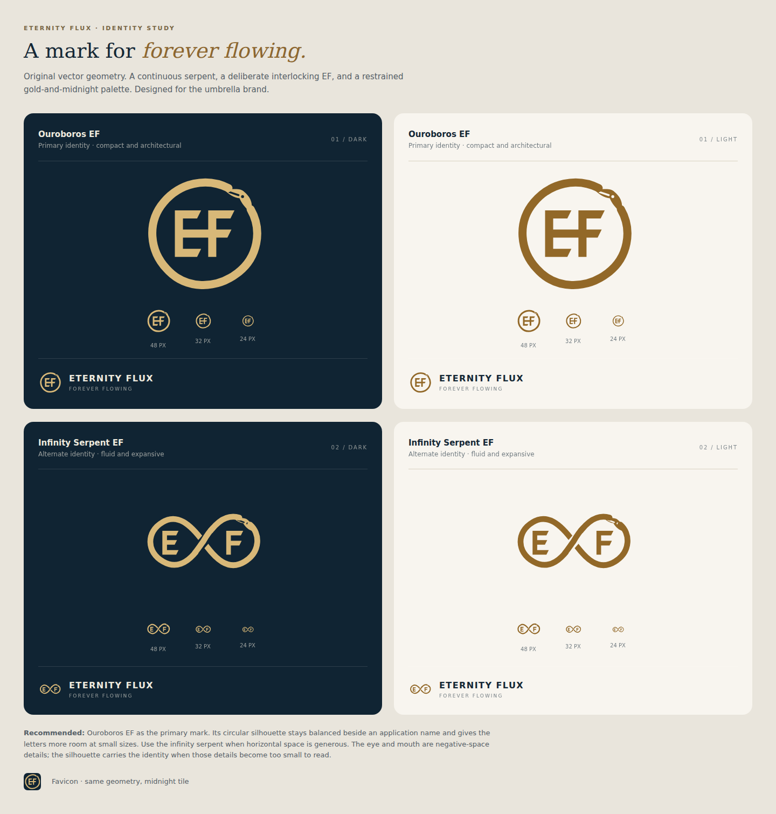

# Eternity Flux identity

The application uses an original **Ouroboros EF** mark: a continuous serpent
surrounding custom geometric E and F letterforms. It represents the umbrella
Eternity Flux identity and the idea of **forever flowing**.

## Editable source

[Open the identity file in Figma](https://www.figma.com/design/eVpYzF8Vit3u6oO67m13Ix/Eternity-Flux-Forever-Flowing-Identity?node-id=1-2).

The SVG artwork was authored as vector paths and imported into Figma as editable
vector node trees. It has no font or bitmap dependency. The Figma file contains
the primary gold and bronze marks and an alternate infinity-serpent direction.

| Asset | Use |
| --- | --- |
| `src/assets/brand/ef-ouroboros-gold.svg` | Primary mark on midnight backgrounds |
| `src/assets/brand/ef-ouroboros-bronze.svg` | Primary mark on light backgrounds |
| `src/assets/brand/ef-ouroboros-ink.svg` | Single-color dark mark |
| `src/assets/brand/ef-infinity-serpent-gold.svg` | Alternate, wider signature |
| `public/favicon.svg` | Primary geometry on a midnight tile |

## In the application

Use the circular ouroboros as the compact application mark. Preserve its aspect
ratio and leave clear space around it. The main navigation uses it at 48 pixels,
with a 40-pixel treatment on small screens. The gold is `#D8B878`; the dark tile
is `#102433`.

The application embeds the SVG in its JavaScript build so the portable HTML
remains self-contained. The favicon is embedded by the offline build script.
Updating the mark must not introduce a remote image request into offline mode.

## License and identity

The software and included artwork use the repository's MIT license. Preserve
the applicable copyright and license notices when redistributing them.
The Eternity Flux name and mark identify this project's origin; inclusion of
the artwork does not imply that Eternity Flux endorses a modified distribution.
Make the authorship and identity of a fork clear to its users.

A product rename does not require a new MIT license. Keep existing browser
storage identifiers and session formats compatible when changing visible names.
